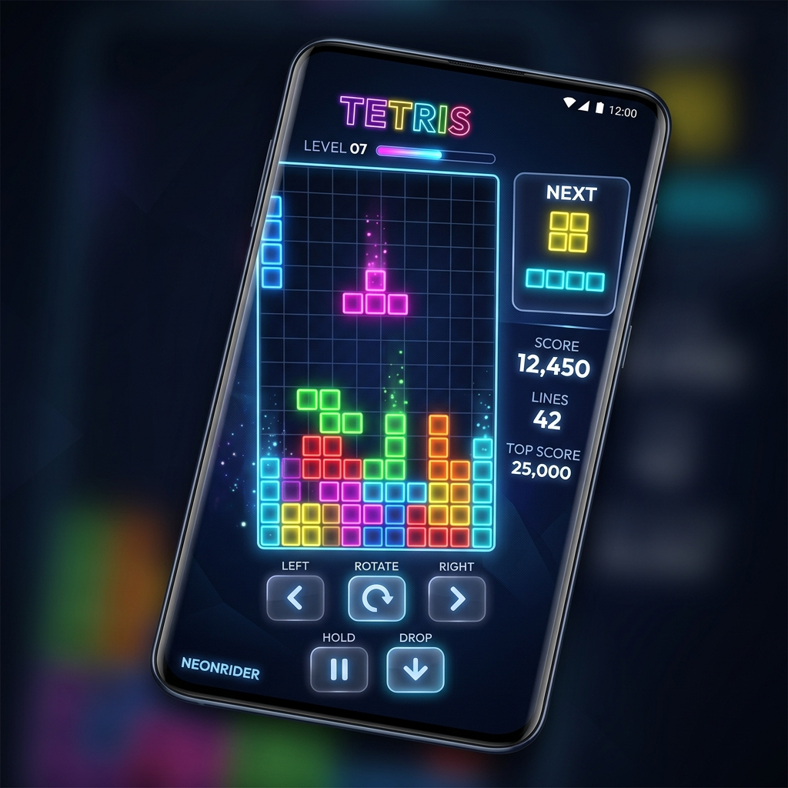

# Tetris - Mathematik & Spiel

Dieses Projekt ist eine interaktive Implementierung des Klassikers **Tetris** für das Galadriel-Ausstellungssystem. Es kombiniert das bekannte Gameplay mit einer Erläuterung der zugrundeliegenden mathematischen und algorithmischen Fragestellungen.

## Screenshot


## Projektplan

Das Projekt wird als eigenständige HTML5/JavaScript-Applikation entwickelt, die in einem GTK3/WebKit2-Fenster im Vollbildmodus läuft.

### Spielfunktionen
- **Klassisches Tetris**: Ein responsives, modernes Tetris-Spiel mit reibungsloser Tastatur- und Touch-Steuerung, Score-Tracker und Vorschau des nächsten Steins.
- **Interaktiver Erklärungsmodus**: Analyse des aktuellen Spielfelds und Erklärung der geometrischen Eigenschaften der fallenden Steine.

### Mathematische Konzepte
- **Polyominos**: Was sind Polyominos und wie sind Tetrominos (4 Quadrate) definiert? (Es gibt 5 freie bzw. 7 einseitige Tetrominos: I, O, T, S, Z, J, L).
- **NP-Vollständigkeit**: Der mathematische Beweis, dass das Finden einer optimalen Strategie (z. B. Maximierung der Zeilen, Überleben) bei einer bekannten Steinsequenz NP-vollständig ist.
- **Geometrie & Symmetrie**: Rotationsgruppen der verschiedenen Tetrominos auf dem diskreten Gitter.
- **Kombinatorik**: Der Zufallsgenerator-Algorithmus (z. B. das "7-Bag"-System) und seine stochastische Auswirkung auf die Spielbarkeit.

## Projektstruktur

- `index.html`: Hauptoberfläche (Spiel- und Mathematikbereich).
- `style.css`: Modernes Design mit responsivem Layout und Dark-Mode-Ästhetik.
- `script.js`: Spiellogik, Rendering, Punktesystem und mathematische Erklärungen.
- `show.py`: Python-GTK3-Wrapper für die Vollbildanzeige.
- `start-tetris`: Startskript zum Ausführen der Anwendung.

## Starten der Anwendung

### Standalone (Lokaler Browser)
Öffnen Sie einfach `index.html` in einem modernen Webbrowser Ihrer Wahl.

### Über Galadriel (Kiosk-Modus)
Führen Sie das Startskript aus:
```bash
./start-tetris
```
